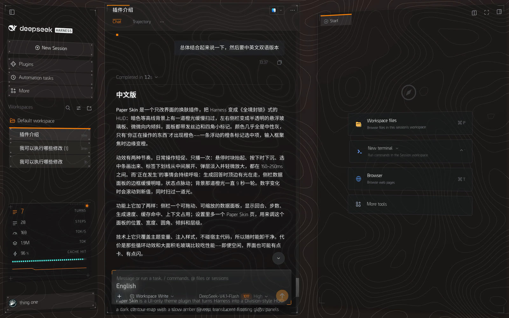
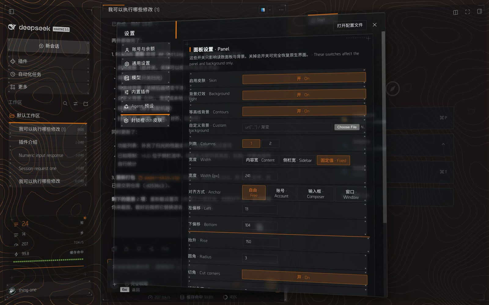
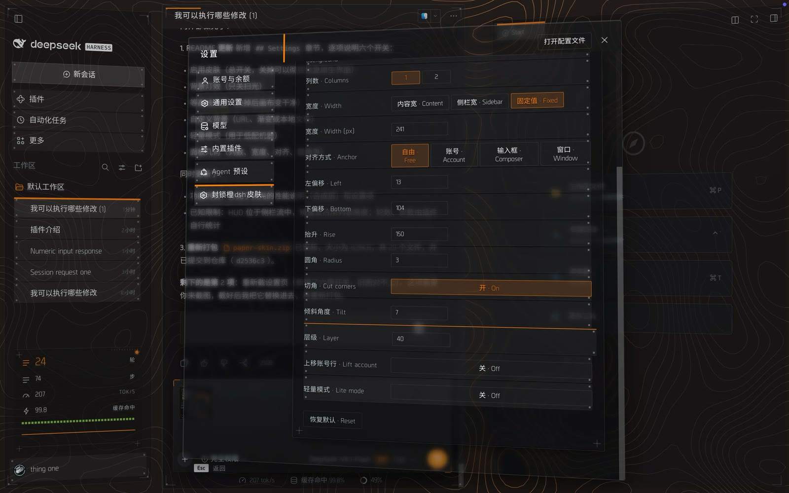
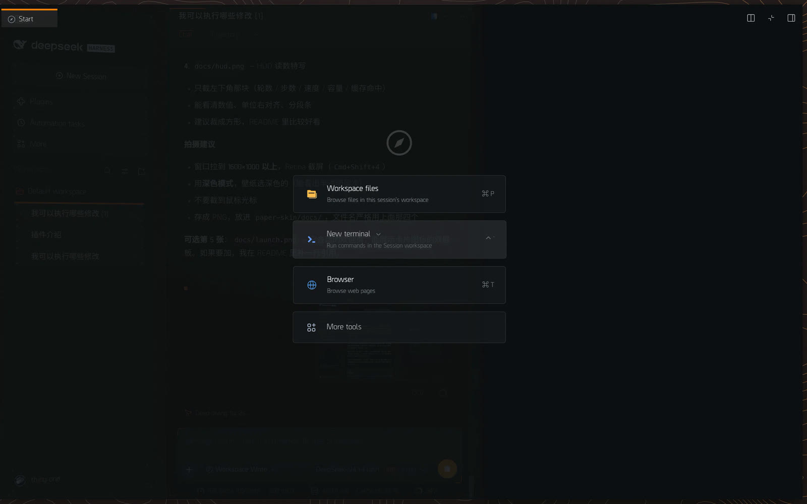
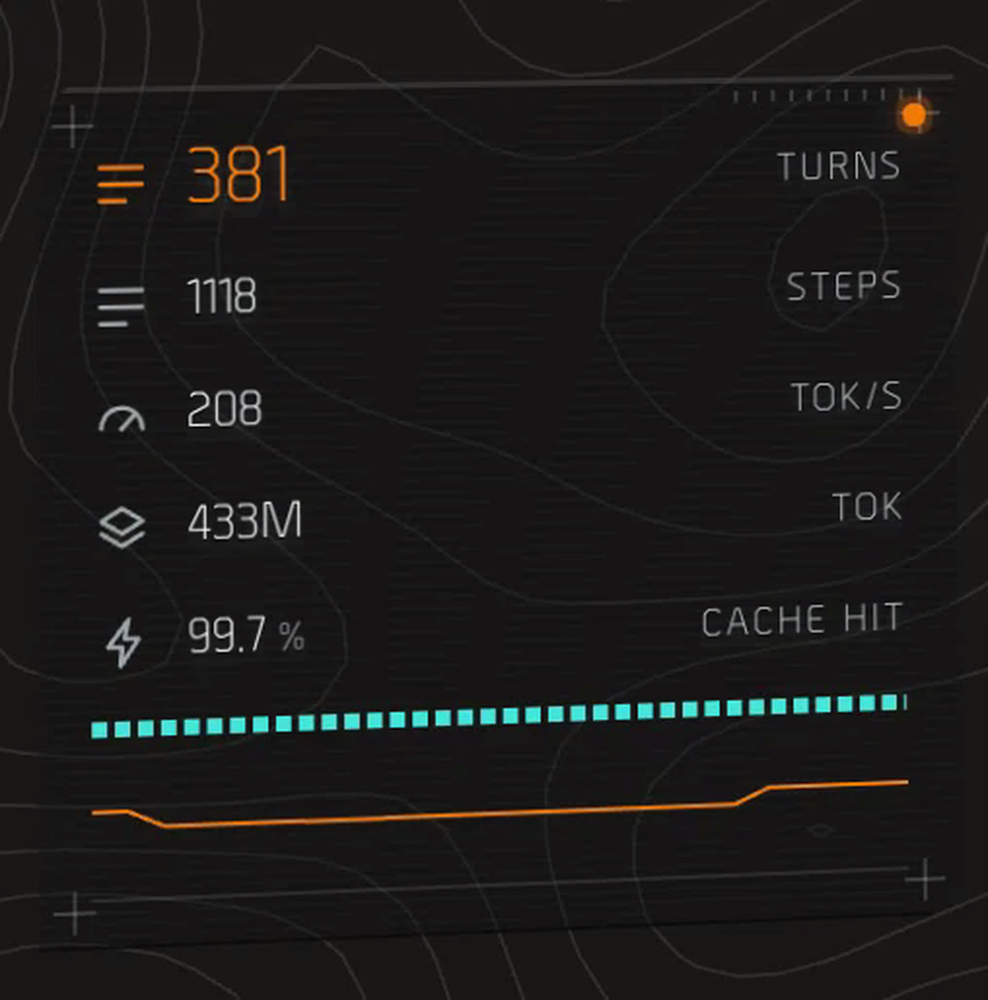

# 封锁橙dsh皮肤插件 (Blockade Orange)

A *Tom Clancy's The Division*-inspired HUD skin for the DeepSeek Harness Web UI.

Three translucent plates float over a live canvas, typography carries the rank
structure, and a single amber accent marks whatever currently has focus.
No core code is patched: it is a client-only plugin that overrides theme tokens
and injects one stylesheet.

> Fan-made, unofficial. Not affiliated with, endorsed by, or sponsored by
> Ubisoft or Massive Entertainment. "Tom Clancy's The Division" is a trademark
> of its respective owners.

## What it does

- **Material**: translucent side plates with a light top edge, hairline seams,
  and a single-point perspective on the left and right columns.
- **Focus language**: an amber bar above the row you are about to pick, which
  stays put on the selected one; rows brighten and lift slightly on hover.
- **Type**: Borda for Latin (see *Fonts* below), Noto Sans SC for Chinese,
  tabular numerals wherever a value can change.
- **HUD cluster**: a movable readout panel in the sidebar mirroring turns,
  steps, throughput, cache hit and context load.
- **Settings**: a glass dialog with the same selection language, plus a
  dedicated section for the HUD geometry.
- **Background**: a contour map with a slow amber sweep (a composited layer, so
  it costs almost nothing while scrolling) over a static terrain.
- **Settings**: a master switch, background-light switch, contour switch, custom
  background, lite mode, and the panel geometry.

## Settings

*Settings → 面板设置 · Panel* holds every switch the skin exposes:

| Switch | What it does |
|---|---|
| 启用皮肤 · Skin | Master switch. Off removes the stylesheet and the token override, restoring the stock interface with no residue. |
| 背景灯效 · Background light | Hides the amber sweep only; the contour map stays. |
| 等高线背景 · Contours | Hides both contour layers, leaving a clean canvas. |
| 自定义背景 · Custom background | Any CSS image: `url("...")`, a gradient, or a local file picked from disk (stored as a data URL). |
| 轻量模式 · Lite mode | Drops the sweep, every backdrop blur and the looping pulses — the switch for weak GPUs. |
| 读面板几何 | Columns, width, anchor, offsets, rise, radius, cut corners, tilt, layer. |

The panel itself lives **inside the sidebar flow**, above the account row, so it
can never cover the session list.


## Screenshots







| Right dock | HUD cluster |
|---|---|
|  |  |


## Install

The plugin is a Cordis bundle. With the Harness CLI available:

```
plugin_manager install_bundle <path-to-this-directory>
```

Then restart the client (`Cmd+Q` on macOS). `Cmd+R` reloads the page but can
leave the client module cached.

## Uninstall / rollback

```
plugin_manager remove_bundle @local/paper-skin
```

Every change lives inside the plugin: theme tokens are re-declared, and one
stylesheet is injected. Removing the bundle restores the stock interface with
no residue — no patched files, no persisted layout state.


## Fonts

The package embeds **Borda** (Northern Block) as WOFF2 subsets for local use —
both in `fonts/` and, base64-encoded, inside `client.js`, which is what the
stylesheet actually loads. **Borda is a commercial typeface and is not
redistributed for reuse**: deleting `fonts/borda-*` removes the copies on disk
but *not* the font embedded in `client.js`. A public build must repack
`client.js` against Titillium Web (SIL Open Font License) and drop the Borda
`@font-face` rules.

`fonts/NOTICE.md` records this in full.

## Tunable knobs

Runtime, from the DevTools console:

```js
__paperSkin.hud.get()                       // current HUD geometry
__paperSkin.hud.set({ bottom: 300 })        // move the cluster
__paperSkin.hud.reset()                     // back to defaults
document.documentElement.style.setProperty('--hud-preselect', '0')  // no bars
```

The HUD panel is also configurable from *Settings → 封锁橙dsh皮肤插件*.

## Known limitations

- **Dock fullscreen round-trip**: closing the dock while it is fullscreen and
  reopening it can leave the host with a "fullscreen state, docked geometry"
  layout. This is a host behaviour; the skin deliberately does not force a
  width to avoid breaking the toggle.
- The readout cluster sits in the sidebar flow: on a very short window it takes
  a share of the list height instead of overlapping it.
- The host only publishes throughput and cache-hit as stats, so the cluster
  counts turns and steps from the transcript itself.
- Some surfaces match host class-name suffixes; an unfamiliar build degrades to
  the stock look rather than breaking.

## License

Code: MIT. Fonts and artwork: see `NOTICE.md`.
